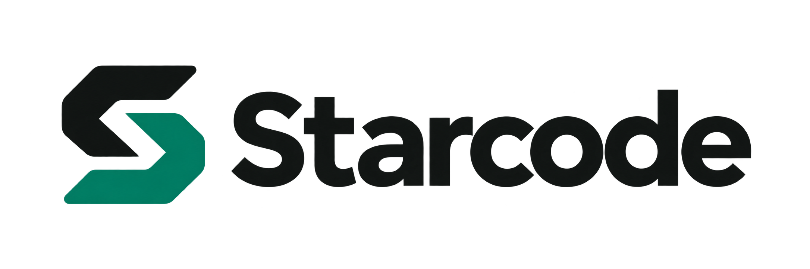

# Starcode



Self-hosted form protection for Shopware 6.7. MIT licensed, without an account,
CAPTCHA subscription or third-party verification requests.

Starcode uses [ALTCHA](https://github.com/altcha-org/altcha) to compute a small
proof of work in the browser. Shopware verifies that proof before accepting a
protected form. It raises the cost of automated submissions; it does not prove
that a visitor is human or stop every bot.

## Install

Version 0.1.1 is an initial release for integration testing. Validate your theme,
extensions and form integrations in an isolated shop before production use.

```sh
composer config repositories.starcode vcs https://github.com/skyyware/starcode
composer require skyyware/starcode:^0.1
php bin/console plugin:refresh
php bin/console plugin:install --activate SkyyStarcode
php bin/console assets:install
php bin/console cache:clear
```

The package includes built browser assets. Node.js is not needed on the shop
server. This VCS installation works without a Packagist listing.

The plugin starts with protection **disabled**. In Administration, open
Extensions > My extensions > Starcode > Configuration, select the sales
channel, choose the forms to protect, and enable protection. Newsletter is the
initial selection. Configuration changes invalidate the relevant shop cache.

## Choose the forms

Selected mode protects the chosen groups plus any additional submission paths.
All mode protects all supported groups plus those paths. It never means every
POST request in the shop.

| Group | Storefront submission path | Store API submission path |
| --- | --- | --- |
| Newsletter | `/form/newsletter` | `/store-api/newsletter/subscribe` |
| Contact | `/form/contact` | `/store-api/contact-form` |
| Registration | `/account/register` | `/store-api/account/register` |
| Password recovery | `/account/recover` | `/store-api/account/recovery-password` |
| Product reviews | `/product/*/rating` | `/store-api/product/*/review` |
| Revocation | `/form/revocation/request` | `/store-api/revocation-request-form` |

Additional paths are **submission endpoints**, not the URL of a page containing
a form. Enter one path per line, such as `/form/custom` or `/form/custom/*`.
The final `*` matches one path segment. Match rules exclude query strings and
sales-channel language prefixes. The controller needs a Shopware storefront or
Store API scope and sales-channel context. Unknown paths are not protected by
guessing their purpose.

Checkout, cart actions, payment routes, administration, webhooks, newsletter
confirmation and unsubscribe are excluded. Review third-party routes before
adding them: a custom payment callback under an unusual URL is still a payment
callback. Never add it to the protected paths.

## Native and scripted forms

Same-origin POST forms receive a compact checkbox using the shop's colors and
font. Newly inserted forms are discovered automatically. Normal submits wait
for verification and keep the original submit button and browser validation.
The widget supports German and English, keyboard input and reduced motion.

Scripts that serialize a form and send it themselves must await the public API
before creating their request body:

```js
await window.Starcode.protect(form);
const body = new FormData(form);
const response = await fetch(form.action, { method: 'POST', body });
```

Call it for each attempt, including retries. A proof is single-use. Do not call
both this API and `requestSubmit()` for the same attempt. Normal submit handlers
can continue using the normal submit event. Scripts registered before Starcode
that send directly from a click, `form.submit()`, or their own fetch need the
adapter above. Server validation still rejects a request without a proof.

For a headless client, request a challenge at
`GET /store-api/starcode/challenge?target=/store-api/newsletter/subscribe`
with the channel's normal `sw-access-key`. Solve it with the ALTCHA 3 client and
send the resulting payload as the `starcode` JSON field or `X-Starcode-Proof`
header on the protected POST. A proof is bound to its sales channel and exact
submission path. The frontend `/starcode/challenge` route is also available.

### External forms and iframes

A script cannot securely protect a form hosted on a different service by
putting a checkbox over it. The receiving server must verify the proof before
performing the subscription or other action.

For an external newsletter iframe, use the provider's supported verification
or replace the iframe with a local form and a separately reviewed server-side
adapter. Starcode does not include a Brevo adapter, read cross-origin frames,
rewrite external requests or claim protection for them. Same-origin embedded
pages must load Starcode themselves.

## Operation and privacy

All challenge, widget and worker requests stay on the shop origin. There is no
external CAPTCHA endpoint, telemetry, fingerprint, interaction recording,
timezone submission or cookie written by Starcode. The host shop can still use
its normal session cookies and access logs.

Proofs expire after five minutes and are consumed atomically in the database.
Challenge issuance is limited to 30 requests per client per minute and 600 per
shop installation per minute. Client identifiers use a keyed hash of the IP;
Starcode does not store the raw IP or form contents. Treat that hash as
pseudonymous data, not anonymous data. Configure trusted proxies correctly so
legitimate visitors do not all share the proxy's rate limit.

Rate records have a two-minute logical lifetime. Expired rate and proof rows
are removed in bounded batches when another challenge is requested. Without
new requests, expired rows remain until later challenge traffic or an operator
runs `php bin/console starcode:cleanup`. Use `--dry-run` to count expired rows
without deleting them. Logical expiry is not a physical deletion deadline.
No consumer, cron job or scheduler is created. Deactivation retains the plugin's
tables. See [maintenance](docs/maintenance.md) for cleanup and upgrades.

This design minimizes data transfers. It is not a legal certification of a
shop's GDPR compliance. The operator still needs an appropriate privacy notice,
log retention, lawful processing and review of other services used by the form.

## Compatibility and verification

Requires Shopware 6.7 and PHP 8.2, 8.3 or 8.4. The PHP tests pass on 8.2.35,
8.3.36 and 8.4.27. Native Shopware 6.7.15.1 form integration was checked on
PHP 8.2.35 with the default Storefront theme. Custom themes and submission
scripts need their own checks. This is not an independent security audit.

The test suite covers scope selection, expiry, malformed payloads, signatures,
replay protection, rate limits, dynamic forms, custom submitters and retries.
An isolated Shopware probe checks real route resolution and controller gating
with business controllers suppressed. It does not send mail or create orders.
Browser checks cover desktop and 320, 390 and 768 pixel widths, checkbox and
keyboard verification, and local-only challenge/worker requests.

```sh
composer install
composer test
composer lint
npm ci --ignore-scripts
npm test
npm run build
```

Development tests require PHP 8.3 or later because of PHPUnit 11. The runtime
requirement remains PHP 8.2. Run the optional integration probe only in a
disposable, anonymized local shop with null mail transport and disabled
outbound integrations:

```sh
php tools/probe-shopware.php /path/to/local/shop https://shop.dev
```

The probe requires the plugin to be enabled. It temporarily selects all groups,
restores the previous selection, removes its own consumed proofs and checks
that customer, order, document, newsletter and message counts did not change.
Rate buckets expire normally. Never run it on production.

## Dependencies and license

Starcode is MIT licensed. ALTCHA PHP is installed through Composer. The bundled
ALTCHA widget and its Svelte runtime are MIT licensed; their notices are in
`src/Resources/public`. Browser assets use ALTCHA 3.5.0 and the PHP integration
uses `altcha-org/altcha` 2.3 or later within major version 2.

For security reporting, see [SECURITY.md](SECURITY.md).
